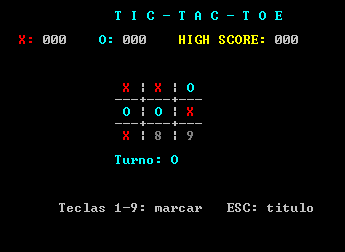

  

Juego de Tic-Tac-Toe (gato) para dos jugadores, en modo texto, escrito en ensamblador 8086 para **Emu8086**.
Proyecto 2 de Arquitectura de Computadoras (EIF205), Escuela de Informática, Universidad Nacional.

**Integrantes:** Simon Canet Porras - Johan Jafeth Zuñiga Rodriguez - Jeremy Calderon Quesada

# Tic-Tac-Toe en ensamblador 8086

## 8.1 Nombre y descripción
**Tic-Tac-Toe (Gato)** es un juego local para dos jugadores, desarrollado en lenguaje ensamblador **x86/8086** para ejecutarse en el emulador **Emu8086**. Se presenta en modo texto y permite llevar un marcador mientras el programa permanece abierto.

## Cómo ejecutarlo

1. Abrir **Emu8086**.
2. `File > Open` y elegir `tic_tac_toe.asm`.
3. Pulsar **Emulate** y luego **Run**.
4. Dar clic en la ventana de pantalla para que reciba el teclado.

## 8.2 Características
* **Dos jugadores** utilizan el mismo teclado.
* **X comienza** y los turnos se alternan después de cada jugada válida.
* Las casillas se seleccionan con las teclas `1` a `9`.
* El programa impide marcar una casilla ocupada.
* Se reconocen victorias horizontales, verticales y diagonales, además de empates.
* Los puntajes se acumulan entre partidas dentro de la misma ejecución.

---

## 8.3 Requisitos y ejecución

> **Requisito principal:** Disponer de **Emu8086** en un entorno compatible y del archivo fuente del proyecto (`.asm`). El código utiliza directivas y servicios propios del entorno 8086 y está preparado para ejecutarse como programa de modo texto.

### Pasos de ejecución:
1. Abrir **Emu8086**.
2. Abrir el archivo fuente `tic_tac_toe.asm` desde el entorno.
3. Utilizar la opción de compilar/ensamblar disponible en Emu8086.
4. Ejecutar el programa desde el emulador y comprobar que aparezca la pantalla de título.

*Nota: Los nombres exactos de las opciones y botones pueden variar según la versión de Emu8086. No se requiere un comando externo de compilación en la documentación de este proyecto.*

---

## 8.4 Controles y reglas

### Controles

| Tecla | Acción |
| :--- | :--- |
| <kbd>ENTER</kbd> | Inicia una partida desde el menú principal. |
| <kbd>1</kbd> a <kbd>9</kbd> | Marca la casilla correspondiente del tablero. |
| <kbd>R</kbd> / <kbd>r</kbd> | Inicia otra partida desde la pantalla de resultado. |
| <kbd>ESC</kbd> | Regresa al menú durante una partida o sale desde las pantallas que ofrecen esa opción. |

### Reglas
* **X** juega primero. Los jugadores alternan turnos.
* Gana quien consigue tres fichas iguales en una fila, columna o diagonal.
* Si las nueve casillas se ocupan sin que exista una línea ganadora, la partida termina en empate.

---

## 8.5 Sistema de puntuación

| Resultado | Puntos asignados |
| :--- | :--- |
| **Victoria de X** | X recibe 3 puntos. |
| **Victoria de O** | O recibe 3 puntos. |
| **Empate** | X recibe 1 punto y O recibe 1 punto. |

> **Nota sobre puntuación:** El *High Score* muestra el mayor puntaje individual entre `scoreX` y `scoreO`. Tanto los puntajes como el *High Score* se mantienen en memoria mientras el programa está ejecutándose; al finalizar el programa, el código no los guarda en un archivo.

---

## 8.6 Organización del código

| Sección | Contenido |
| :--- | :--- |
| `.model` / `.stack` | Modelo de memoria y reserva de pila. |
| `.data` | Tablero, estado, puntajes, combinaciones ganadoras y mensajes. |
| `Macros` | Operaciones repetitivas para preservar registros, posicionar cursor e imprimir. |
| `.code` | Procedimientos de inicialización, interfaz, entrada, lógica del juego y puntuación. |
